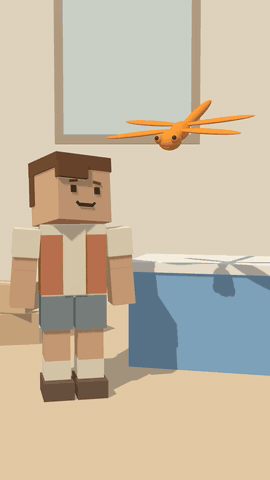

# ai-3d-video

AI エージェント（Claude Code / Gemini CLI など）に、**同じキャラクターが出てくる 3D ショート動画**を作らせるためのスキルです。セリフを書いた JSON と、動きを書いた HTML 1 枚から、口パク付きの縦型（9:16）または横型（16:9）の MP4 を書き出します。



*An agent skill that renders short 3D character videos (Three.js + VOICEVOX lip-sync + headless Chrome + ffmpeg). Docs are in Japanese; `SKILL.md` (English) is the agent-facing reference.*

## できること

- **キャラクターが毎回同じ**：少年・とんぼの形と色はライブラリに固定してあり、シーンごとに作り直しません。
- **セリフと口パク**：VOICEVOX で声を作り、音量に合わせて口が動きます。BGM と字幕ファイル（SRT）も同時に出ます。
- **めり込まない小道具**：下から順に積む、画面外から手渡す、たすきを頭から掛ける、といった動きが部品になっています。
- **速い下見**：約 10 秒で、動画全体を 1 枚の一覧画像にします。エージェントが確認に使う画像が 1 枚で済みます。
- **字幕なし／焼き込みを選べる**：あとで編集する前提なら字幕なしで書き出せます。

## 必要なもの

| もの | 用途 |
|---|---|
| Python 3.9 以上 | スクリプトの実行（追加ライブラリは不要） |
| [ffmpeg](https://ffmpeg.org/) | 音声の合成と動画の書き出し |
| Google Chrome または Chromium | 3D の描画（画面は開きません） |
| [VOICEVOX](https://voicevox.hiroshiba.jp/) | 声の生成。起動しておく（`127.0.0.1:50021`） |

macOS で動作を確認しています。Windows / Linux でも動くように書いてありますが、未確認です。Chrome が見つからないときは `--chrome <パス>` か環境変数 `CHROME_PATH` で指定してください。字幕を焼き込む場合、既定のフォントは macOS のヒラギノです。ほかの OS では `--subtitle-font` で指定してください。

## 入れ方

リポジトリを、使っているエージェントのスキル置き場に置きます。

```bash
git clone https://github.com/sooooooooo101/ai-3d-video.git ~/.claude/skills/ai-3d-video
```

Gemini CLI なら `~/.gemini/config/skills/ai-3d-video` など、それぞれのスキル置き場に読み替えてください。エージェントを使わず、手で実行することもできます。

## まず動かす

同梱のサンプル「受付だけ」（15 秒）を作ります。VOICEVOX を起動してから実行してください。

```bash
SKILL=~/.claude/skills/ai-3d-video
mkdir my-video && cd my-video
cp "$SKILL"/assets/*.js .
cp "$SKILL"/examples/uketsuke-dake/{scene.html,dialogue.json} .

python3 "$SKILL"/scripts/audio_pipeline.py --script dialogue.json --out-dir .
python3 "$SKILL"/scripts/render_batch.py --work-dir . --aspect 9:16 --preview
python3 "$SKILL"/scripts/render_batch.py --work-dir . --aspect 9:16 --subtitles none --out out.mp4
```

2 行目のコマンドで `preview.png`（全体の一覧画像）、3 行目で `out.mp4` ができます。

## エージェントへの頼み方

秒数ごとに「誰が何をして、何を言うか」を書くと、質問なしで進みます。

```text
少年ととんぼで、15秒の縦型コメディ動画を作って。
【0〜3秒】とんぼが受付の机を指す。とんぼ「受付だけ、お願い！」／少年「それなら任せて！」
【3〜8秒】段ボール、カメラ、ノートPCが順に渡される。…
字幕とたすきの文字は無地で。
```

## 自分で書く場合

作るファイルは 2 つです。

**`dialogue.json`**（セリフ）

| 項目 | 意味 |
|---|---|
| `fps` / `total_sec` | コマ数と長さ（秒） |
| `bgm_stop_sec` | BGM を止める時刻。省略すると最後まで鳴る |
| `sfx[]` | 効果音や環境音（任意）。`file`（dialogue.json からの相対パス）、`start`（鳴らし始める秒）、`volume` |
| `lines[].role` | 口パクの宛先（`boy`、`df` など。シーン側で `mouth.boy` として受け取る） |
| `lines[].speaker_id` | VOICEVOX の声の番号。**同じキャラクターは同じ番号にする**（声色違いの番号を混ぜると別人に聞こえます） |
| `lines[].start` | 話し始める時刻（秒） |
| `lines[].max_dur` | この秒数を超えたら早回しして収める |
| `lines[].speed` / `pitch` | 話す速さ／声の高さ |
| `lines[].text` | セリフ |

小道具が出るきっかけになる言葉は、1 行ずつに分けると合わせやすくなります。

**`scene.html`**（動き）

`examples/uketsuke-dake/scene.html` を書き換えるのが早道です。描画や照明は `stage.js` が受け持つので、書くのは「時刻 `t` のとき、誰がどこにいて、どんな顔か」だけです。使える部品と寸法の一覧は [SKILL.md](SKILL.md) にあります。

**主なオプション**

| コマンド | オプション |
|---|---|
| `audio_pipeline.py` | `--bgm 曲.mp3`（自分の曲を使う）、`--bgm-volume 0.6`、`--require-voicevox`（VOICEVOX が無ければ止まる） |
| `render_batch.py` | `--preview`（下見）、`--step 5`（下見のコマ間隔）、`--subtitles burn`（字幕を焼き込む）、`--timeout 600`、`--chrome`、`--subtitle-font` |

## フォルダ構成

```text
SKILL.md                 エージェント向けの説明書（部品と寸法の一覧）
assets/                  three.min.js、キャラクター、小道具、描画の土台
scripts/                 audio_pipeline.py（声・BGM・口パク・字幕）、render_batch.py（描画・書き出し）
examples/uketsuke-dake/  サンプル「受付だけ」
references/              VOICEVOX の声の番号
```

## 音声のクレジット

このリポジトリに VOICEVOX 本体や声のデータは入っていません。VOICEVOX で作った音声を公開するときは、**使った声ごとにクレジット表記が必要**です。サンプルで使っている声の場合は次のとおりです。

```text
VOICEVOX:春日部つむぎ
VOICEVOX:玄野武宏
```

どちらも、この表記を入れれば商用・非商用で使えるとされています（VOICEVOX 0.26.1 に同梱の規約文による）。規約は変わることがあるので、公開前に各キャラクターの最新の利用規約を確認してください。

- 春日部つむぎ：https://tsumugi-official.studio.site/rule
- 玄野武宏：https://www.virvoxproject.com/voicevoxの利用規約
- VOICEVOX：https://voicevox.hiroshiba.jp/term/

ほかの声を使う場合も、VOICEVOX のアプリ内でその声の規約を確認してください。

## キャラクターについて

同梱の「少年」「とんぼ」のデザインも、コードと同じ MIT ライセンスで自由に使えます。そのまま自分の動画に登場させても、色や形を変えても、商用で使ってもかまいません。クレジット表記は任意です。

自分のキャラクターを使いたい場合は、`assets/characters.js` に同じ形の関数（`group`、`setMouth` などを返すもの）を足してください。

## 既知の制限

- 既定は 15fps です。口パクもこの細かさで作られます。
- 同梱の BGM は簡単な電子音です。作品には `--bgm` で自分の曲を指定することをおすすめします。
- 描画はソフトウェア処理（SwiftShader）なので、複雑なシーンでは時間がかかります。
- VOICEVOX が起動していない macOS では、警告を出したうえで OS の読み上げ音声に切り替わります（声は変わります）。

## ライセンス

コードとキャラクターのデザインは [MIT License](LICENSE) です。同梱している three.js の表示は [THIRD_PARTY_NOTICES.md](THIRD_PARTY_NOTICES.md) にあります。VOICEVOX で生成した音声には、上の「音声のクレジット」の条件がかかります。
