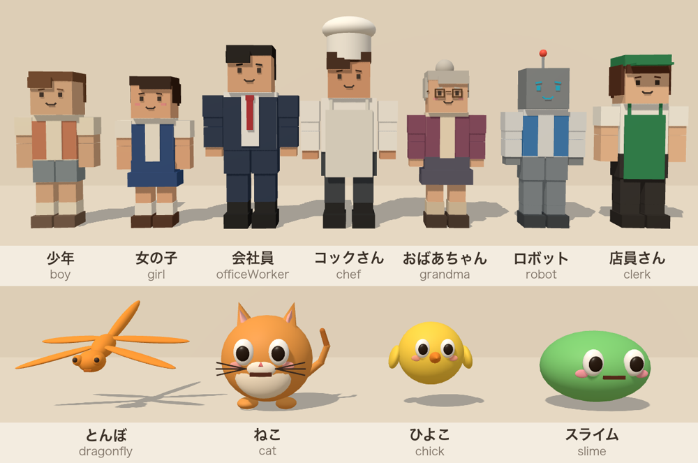

# ai-3d-video

AI エージェント（Claude Code / Gemini CLI など）に、**同じキャラクターが出てくる 3D ショート動画**を作らせるためのスキルです。コメディ、解説、お仕事あるある、広告など、ジャンルは問いません。出演者は同梱の 11 体から選ぶか、髪型や服の色を指定して自分で作れます。会社・キッチン・リビング・お店・公園・学校のホールといった舞台も用意してあります。

動画の中身は、日本語で穴埋めする **企画書**（[`templates/kikaku.md`](templates/kikaku.md)）で決めます。エージェントはそれを読んで、セリフと動きを書き、口パク付きの縦型（9:16）または横型（16:9）の MP4 を書き出します。


*An agent skill that renders short 3D character videos (Three.js + VOICEVOX lip-sync + headless Chrome + ffmpeg). Docs are in Japanese; `SKILL.md` (English) is the agent-facing reference.*

## できること

- **企画書から作る**：技術の言葉を使わない企画書に書くだけ。わからない所は「おまかせ」で、エージェントが決めて書き戻します。
- **キャラクターが毎回同じ**：出演者の形と色はライブラリで決まっていて、シーンごとに作り直しません。自分のキャラは、色や髪型を並べた設定を 1 つ足すだけで増やせます。
- **どんな舞台でも**：6 つの舞台と、机・椅子・棚・モニター・木・看板などの小道具があります。
- **セリフと口パク**：VOICEVOX で声を作り、音量に合わせて口が動きます。BGM と字幕ファイル（SRT）も同時に出ます。
- **めり込まない小道具**：下から順に積む、画面外から手渡す、たすきを頭から掛ける、といった動きが部品になっています。
- **速い下見**：約 10 秒で、動画全体を 1 枚の一覧画像にします。エージェントが確認に使う画像が 1 枚で済みます。
- **字幕なし／焼き込みを選べる**：あとで編集する前提なら字幕なしで書き出せます。

## 必要なもの

| もの | 用途 |
|---|---|
| Python 3.9 以上 | スクリプトの実行（追加ライブラリは不要） |
| [ffmpeg](https://ffmpeg.org/) | 音声の合成と動画の書き出し |
| Google Chrome または Chromium | 3D の描画（画面は開きません） |
| [VOICEVOX](https://voicevox.hiroshiba.jp/) | 声の生成。起動しておく（`127.0.0.1:50021`） |

macOS で動作を確認しています。Windows / Linux でも動くように書いてありますが、未確認です。Chrome が見つからないときは `--chrome <パス>` か環境変数 `CHROME_PATH` で指定してください。字幕を焼き込む場合、既定のフォントは macOS のヒラギノです。ほかの OS では `--subtitle-font` で指定してください。

## 入れ方

リポジトリを、使っているエージェントのスキル置き場に置きます。

```bash
git clone https://github.com/sooooooooo101/ai-3d-video.git ~/.claude/skills/ai-3d-video
```

Gemini CLI なら `~/.gemini/config/skills/ai-3d-video` など、それぞれのスキル置き場に読み替えてください。エージェントを使わず、手で実行することもできます。

## 企画書の書き方

動画づくりは、企画書を書くところから始まります。テンプレートは [`templates/kikaku.md`](templates/kikaku.md) です。

- **冒頭の「かんたん版」5 問だけで作れます**（どんな動画か一言／誰が出るか／どこで／長さと向き／オチ）。
- **どの項目も「おまかせ」でかまいません。** 空けておいても大丈夫です。エージェントが決めて、決めた所に「（仮）」と付けて書き戻します。気に入らない所だけ直してください。
- もっと細かく決めたい人は、下の「くわしく決めたい人向け」に、登場人物の見た目・性格・声の感じ、場面ごとの流れ、音楽、やってほしくないことを書けます。
- 直してほしいときも、企画書を直して渡すのがいちばん確実です（企画書が正になります）。

かんたん版の記入例：

```text
1. どんな動画？：新人ロボットが、料理長の「塩少々」を真に受けて困らせるコメディ
2. 誰が出る？　：料理長（コックさん）と、新人のロボット
3. どこで？　　：レストランの厨房
4. 長さと向き　：12秒くらい・縦
5. オチ　　　　：最後に料理長が真顔でこっちを向いて「…売ってない。」
```

同梱の見本 3 本には、それぞれの動画を作ったときの企画書（`examples/*/kikaku.md`）が入っています。

## 出演者一覧



絵の下に、企画書で使う日本語の名前と、エージェントが使う名前を書いてあります。上の段は人の形の出演者 7 人（少年 `boy`／女の子 `girl`／会社員 `officeWorker`／コックさん `chef`／おばあちゃん `grandma`／ロボット `robot`／店員さん `clerk`）、下の段は人の形でない相棒 4 体（とんぼ `dragonfly`／ねこ `cat`／ひよこ `chick`／スライム `slime`）です。相棒には手がありません。

企画書では日本語の名前で選べば十分です。一覧に無い見た目は、言葉で書いてください（例：「メガネの先生、紺のジャケット、ボブヘア」）。エージェントが設定を作ります。

### 自分のキャラクターを足す

`assets/cast.js` に、色と形を並べた設定を 1 つ足すだけです。いちばん近い出演者をコピーして書き換えるのが早道です。

```js
teacher: {
  kind: 'humanoid', hairStyle: 'bob', hair: '#3b2a20', glasses: '#333333',
  top: '#ffffff', topAccent: '#2b3a55', topAccentStyle: 'jacket', bottom: '#2b3a55', bottomStyle: 'skirt',
  height: 1.15, headScale: 0.92,
},
```

選べる項目：髪型（short / bob / long / ponytail / bun / cap / bald）、帽子（cap / chef / helmet / beanie / antenna）、上着（ベスト / ジャケット）、下（短パン / 長ズボン / スカート）、袖、メガネ・ネクタイ・エプロン・ほっぺ、背の高さ、体の幅。人の形でない相棒（`kind: 'mascot'`）は、体の色、耳（ねこ / くま / うさぎ）、羽、しっぽ、くちばし、浮くかどうかを選べます。全項目は [references/api.md](references/api.md) にあります。

## まず動かす

同梱のサンプル「受付だけ」（15 秒）を作ります。VOICEVOX を起動してから実行してください。

```bash
SKILL=~/.claude/skills/ai-3d-video
mkdir my-video && cd my-video
cp "$SKILL"/assets/*.js .
cp "$SKILL"/examples/uketsuke-dake/{scene.html,dialogue.json} .

python3 "$SKILL"/scripts/audio_pipeline.py --script dialogue.json --out-dir .
python3 "$SKILL"/scripts/render_batch.py --work-dir . --aspect 9:16 --preview
python3 "$SKILL"/scripts/render_batch.py --work-dir . --aspect 9:16 --subtitles none --out out.mp4
```

2 行目のコマンドで `preview.png`（全体の一覧画像）、3 行目で `out.mp4` ができます。

### サンプル 2 本目：「図面どおり」（20 秒）

場面の切り替え（屋内の会議 → 屋外の当日）、自分の BGM、効果音（風）を使う例です。図面の小道具、屋外の会場、木、看板は `scene.html` の中で組み立てています。

```bash
cp "$SKILL"/examples/zumen-doori/* .
python3 "$SKILL"/scripts/audio_pipeline.py --script dialogue.json --out-dir . --bgm bgm_calm.mp3 --bgm-volume 0.9
python3 "$SKILL"/scripts/render_batch.py --work-dir . --aspect 9:16 --subtitles none --out out.mp4
```

同梱の `bgm_calm.mp3`（のんびり）、`wind.mp3`（風の音）、`assets/bgm_tense.mp3`（ドキドキ）はこのリポジトリ用にプログラムで生成した音で、コードと同じ MIT ライセンスで使えます。

### サンプル 3 本目：「塩少々」（12 秒）

学校以外のジャンルの例です。コックさんとロボットが、キッチンの舞台で掛け合います。新人ロボットが料理長の「塩少々」を真に受け、「勘をダウンロードします」と言い出すコメディです。企画書（`kikaku.md`）を先に書き、それだけを見てセリフと動きを作りました。

```bash
mkdir shio && cd shio
cp "$SKILL"/assets/*.js .
cp "$SKILL"/examples/shio-shoushou/* .
python3 "$SKILL"/scripts/audio_pipeline.py --script dialogue.json --out-dir . --bgm "$SKILL"/examples/zumen-doori/bgm_calm.mp3
python3 "$SKILL"/scripts/render_batch.py --work-dir . --aspect 9:16 --preview
python3 "$SKILL"/scripts/render_batch.py --work-dir . --aspect 9:16 --subtitles none --out out.mp4
```

### ジャンル別の組み合わせ例

| ジャンル | 出演者 | 舞台 | 構図 |
|---|---|---|---|
| お仕事あるある | 会社員 ＋ ロボット | 会社 `office` | 2 人（`duoHumans916`） |
| 料理・お店 | コックさん ＋ 店員さん | キッチン `kitchen` / お店 `shop` | 2 人 |
| 家族のほのぼの | おばあちゃん ＋ 女の子 ＋ ねこ | リビング `livingRoom` | 3 人（`trio916`） |
| 解説・紹介 | 会社員 1 人（＋ ひよこ） | 会社 / 公園 | 1 人（`solo916`） |
| 学校・イベント | 少年 ＋ とんぼ | 学校のホール `schoolHall` | 人 ＋ 相棒（`duo916`） |
| 横長の動画 | だれでも 2 人 | どこでも | 横 2 人（`duo169`） |

## エージェントへの頼み方

企画書を渡して「この企画書で動画を作って」と頼みます。かんたん版だけでも作れます。

```text
この企画書で動画を作って。（kikaku.md を添付、または中身を貼り付け）
```

企画書が無くても、一言で頼めます（例：「おばあちゃんとねこで、リビングのほのぼの動画を10秒で」）。そのときはエージェントが企画書を作り、足りない所を（仮）で埋めます。結果を大きく左右する点（オチ、出演者、長さ）だけ、多くて 3 つまで質問が来ることがあります。仮で決めた所が多いときは、作り始める前に企画書の要点を見せて確認を取ります。完成したら、仮で決めた点の一覧が届きます。

## 自分で書く場合

作るファイルは 2 つです。

**`dialogue.json`**（セリフ）

| 項目 | 意味 |
|---|---|
| `fps` / `total_sec` | コマ数と長さ（秒） |
| `bgm_stop_sec` | BGM を止める時刻。省略すると最後まで鳴る |
| `sfx[]` | 効果音や環境音（任意）。`file`（dialogue.json からの相対パス）、`start`（鳴らし始める秒）、`volume` |
| `lines[].role` | 口パクの宛先（`boy`、`df` など。シーン側で `mouth.boy` として受け取る） |
| `lines[].speaker_id` | VOICEVOX の声の番号。**同じキャラクターは同じ番号にする**（声色違いの番号を混ぜると別人に聞こえます） |
| `lines[].start` | 話し始める時刻（秒） |
| `lines[].max_dur` | この秒数を超えたら早回しして収める |
| `lines[].speed` / `pitch` | 話す速さ／声の高さ |
| `lines[].text` | セリフ |

小道具が出るきっかけになる言葉は、1 行ずつに分けると合わせやすくなります。

**`scene.html`**（動き）

いちばん近いサンプルの `scene.html` を書き換えるのが早道です（新しい出演者や舞台なら `examples/shio-shoushou/`）。描画や照明は `stage.js` が受け持つので、書くのは「時刻 `t` のとき、誰がどこにいて、どんな顔か」だけです。使える部品と寸法の一覧は [SKILL.md](SKILL.md) と [references/api.md](references/api.md) にあります。

**主なオプション**

| コマンド | オプション |
|---|---|
| `audio_pipeline.py` | `--bgm 曲.mp3`（自分の曲を使う）、`--bgm none`（音楽なし）、`--bgm-volume 0.6`、`--require-voicevox`（VOICEVOX が無ければ止まる） |
| `render_batch.py` | `--preview`（下見）、`--step 5`（下見のコマ間隔）、`--subtitles burn`（字幕を焼き込む）、`--timeout 600`、`--chrome`、`--subtitle-font` |

## フォルダ構成

```text
SKILL.md                 エージェント向けの説明書（企画書の進め方、部品の要約）
templates/kikaku.md      企画書のテンプレート
assets/                  three.min.js、キャラクター（characters.js）、出演者一覧（cast.js）、舞台と小道具（props.js）、描画の土台（stage.js）
scripts/                 audio_pipeline.py（声・BGM・口パク・字幕）、render_batch.py（描画・書き出し）
examples/uketsuke-dake/  サンプル「受付だけ」
examples/zumen-doori/    サンプル「図面どおり」（場面切り替え・BGM・効果音）
examples/shio-shoushou/  サンプル「塩少々」（コックさんとロボット、キッチン）
references/              API の全一覧（api.md）、VOICEVOX の声の番号と声の選び方
docs/                    デモ動画、出演者一覧の絵
```

## 音声のクレジット

このリポジトリに VOICEVOX 本体や声のデータは入っていません。VOICEVOX で作った音声を公開するときは、**使った声ごとにクレジット表記が必要**です。サンプルで使っている声の場合は次のとおりです。

```text
VOICEVOX:春日部つむぎ
VOICEVOX:玄野武宏
```

「塩少々」では次の 2 つの声を使っています。

```text
VOICEVOX:青山龍星
VOICEVOX:ナースロボ＿タイプＴ
```

どちらも、この表記を入れれば商用・非商用で使えるとされています（VOICEVOX 0.26.1 に同梱の規約文による）。ただし青山龍星は、**企業が関わる形で使う場合は事前の確認が必要**とされています。

- 青山龍星：https://www.virvoxproject.com/voicevoxの利用規約
- ナースロボ＿タイプＴ：https://www.krnr.top/rules

春日部つむぎ・玄野武宏は、この表記を入れれば商用・非商用で使えるとされています（VOICEVOX 0.26.1 に同梱の規約文による）。規約は変わることがあるので、公開前に各キャラクターの最新の利用規約を確認してください。

- 春日部つむぎ：https://tsumugi-official.studio.site/rule
- 玄野武宏：https://www.virvoxproject.com/voicevoxの利用規約
- VOICEVOX：https://voicevox.hiroshiba.jp/term/

ほかの声（青山龍星、ナースロボ＿タイプＴ を含む）を使う場合も、VOICEVOX のアプリ内でその声の規約を確認してください。声の感じごとのおすすめは [references/voicevox_speakers.md](references/voicevox_speakers.md) にあります。

## キャラクターについて

同梱の「少年」「とんぼ」のデザインも、コードと同じ MIT ライセンスで自由に使えます。そのまま自分の動画に登場させても、色や形を変えても、商用で使ってもかまいません。クレジット表記は任意です。ほかの同梱出演者（女の子、会社員、コックさん、おばあちゃん、ロボット、店員さん、ねこ、ひよこ、スライム）も同じ条件です。

自分のキャラクターの足し方は、上の「自分のキャラクターを足す」を見てください。

## 既知の制限

- 既定は 15fps です。口パクもこの細かさで作られます。
- 同梱の BGM（内蔵の明るいループ、のんびり、ドキドキ）は簡単な電子音です。作品には `--bgm` で自分の曲を指定することをおすすめします。
- 描画はソフトウェア処理（SwiftShader）なので、複雑なシーンでは時間がかかります。
- VOICEVOX が起動していない macOS では、警告を出したうえで OS の読み上げ音声に切り替わります（声は変わります）。

## ライセンス

コードとキャラクターのデザインは [MIT License](LICENSE) です。同梱している three.js の表示は [THIRD_PARTY_NOTICES.md](THIRD_PARTY_NOTICES.md) にあります。VOICEVOX で生成した音声には、上の「音声のクレジット」の条件がかかります。
